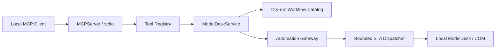

# Architecture

[../README.md](../README.md) | [tools.md](tools.md) | [extending.md](extending.md)

ModelDesk MCP is a Python 3.14 source-checkout server using the **MCP Python SDK 2.x**, its `MCPServer` class, local stdio, and a centralized Windows COM bridge. Its layers separate protocol handling, domain requests, and thread-affine automation.

## Request Flow

Planning stays in the local catalog. A workflow plan describes lower-level calls; it does not execute them or provide transaction handling.

## Module Responsibilities

| Module | Responsibility |
| --- | --- |
| [../ModelDeskMCP.cmd](../ModelDeskMCP.cmd) | Resolve the checkout, invoke uv or its Python-module fallback, forward arguments and exit codes. |
| [../src/modeldesk_mcp/server.py](../src/modeldesk_mcp/server.py) | CLI metadata, MCPServer application creation, and stdio entry point. |
| [../src/modeldesk_mcp/tools/registry.py](../src/modeldesk_mcp/tools/registry.py) | Fixed names, owner domains, SDK-native input descriptions/examples, output envelope, service wrappers. |
| [../src/modeldesk_mcp/contracts/requests.py](../src/modeldesk_mcp/contracts/requests.py) | Typed request parsing and operation-specific validation. |
| [../src/modeldesk_mcp/contracts/models.py](../src/modeldesk_mcp/contracts/models.py) | Result models, serialization, and exception-message path redaction. |
| [../src/modeldesk_mcp/contracts/use_cases.py](../src/modeldesk_mcp/contracts/use_cases.py) | Canonical UC1-UC5/Supporting tool tags and query normalization. |
| [../src/modeldesk_mcp/domain/service.py](../src/modeldesk_mcp/domain/service.py) | Public service methods and routing to the gateway/catalog. |
| [../src/modeldesk_mcp/domain/workflow_catalog.py](../src/modeldesk_mcp/domain/workflow_catalog.py) | Named, local dry-run recipes. |
| [../src/modeldesk_mcp/domain/capture_comparison.py](../src/modeldesk_mcp/domain/capture_comparison.py) | Read-only project-local MAT parsing, signal alignment, metrics, and tolerance evaluation. |
| [../src/modeldesk_mcp/com_bridge/gateway.py](../src/modeldesk_mcp/com_bridge/gateway.py) | Context resolution, ModelDesk operations, readback, persistence controls, structured failures. |
| [../src/modeldesk_mcp/com_bridge/dispatcher.py](../src/modeldesk_mcp/com_bridge/dispatcher.py) | COM initialization, a single STA worker, bounded submission, wait timeout, and shutdown. |
| [../src/modeldesk_mcp/com_bridge/accessor.py](../src/modeldesk_mcp/com_bridge/accessor.py) | Late-bound property/member access, selectors, and collection snapshots. |
| [../src/modeldesk_mcp/config.py](../src/modeldesk_mcp/config.py) | Environment-based ProgID, timeout, and collection limits. |

## Public Contract

The registry exposes exactly 83 explicit `modeldesk_` names. Tools are not discovered from arbitrary source files at runtime. No MCP resources or prompts are registered.

MCPServer receives SDK-supported `Annotated`/`Field` parameter metadata and a typed output envelope. MCP validation and typed request validation complement each other: the former describes outer arguments, while the latter checks JSON payloads and domain-specific constraints.

All handler results serialize the seven fields documented in [error-handling.md](error-handling.md). Nested `data` stays operation-specific. Wrappers forward to service methods and never perform direct COM work.

## Ownership and Use Cases

The five internal owner domains are:

| Domain | Owns |
| --- | --- |
| General COM Automation | Lifecycle, pools, models, parameters, processing, testing, and planning. |
| Scenario/TrafficScenario | Scenario content, Fellows, maneuvers, references, and maneuver runtime controls. |
| Road/RoadGenerator | Road networks, roads, segments, lanes, road-local objects, and connections. |
| Plotting/PlotManager | Plotting configurations, captures/layouts, and capture comparison. |
| TrafficObjectManager/TrafficObject/TOM | Catalog objects, folders, and reference validation. |

Each tool has one owner domain but can have multiple use-case tags. The six functional groups in [tools.md](tools.md) are a reader-oriented inventory, not additional runtime domains.

## COM Lifecycle and Ordering

The gateway keeps the application connection within the bridge and resolves the active project, experiment, and selected child objects for each operation. Do not retain deep COM child objects across requests: activation, deletion, or other user actions can invalidate them.

Automation callbacks run on one STA worker. A bounded queue prevents unlimited submissions; accepted work and dispatcher shutdown are coordinated. Queue serialization does not define dependency order between concurrently submitted MCP calls. Clients must await a mutation before issuing a dependent read or write.

The default 60-second timeout bounds the caller's wait. It does not interrupt ModelDesk or cancel queued/running COM work. Collection snapshots default to at most 500 items and can report truncation. Configuration details are in [clients.md](clients.md).

## Mutation and Recovery Boundaries

Typed request validation rejects invalid inputs before mutation where possible. Some decisions require a live COM object. Compound operations can still fail after an earlier step has changed in-memory state; there is no automatic rollback.

Supported profile updates read back assigned values before optional Save/Download. A failed readback or later persistence action does not reverse preceding assignments. Immutable maneuver indices are never used as a reordering mechanism.

Exception-derived errors pass through local-path redaction. Domain data and artifact references can retain useful project paths. This local integration has no authentication or remote isolation layer; treat the client as a trusted caller with the server process's permissions.

## Verification Boundaries

Metadata flags bypass application/runtime creation. Deterministic tests use source-shaped fakes and SDK schema checks; the COM-free smoke check verifies protocol discovery and safe local paths without requiring ModelDesk.

GitHub CI checks Windows/Python 3.14 installation, launcher metadata, syntax, pytest, and COM-free smoke behavior. These gates do not certify project-specific processing, test execution, downloads, AURELION, or every live COM object shape. Live checks need controlled fixtures and explicit mutation/runtime intent.

Use [extending.md](extending.md) when adding behavior and [error-handling.md](error-handling.md) when designing recovery.
